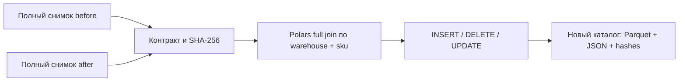

# Как я нахожу изменения складских остатков

Я сделал учебный инструмент **polars-stock-diff 0.1.0**: сравниваю два полных
CSV-снимка склада, нахожу INSERT/DELETE/UPDATE и сохраняю типизированный Parquet
со сводкой JSON. Неполный пакет, дубли ключей и неправильные количества я отклоняю.
Все примеры синтетические. Коммерческий опыт и интеграцию с реальной WMS не заявляю.

Я использую **Polars 2.1.0** и Python 3.12. Сервер, Docker, облако и база не нужны.
Вместо применения изменений к учётной системе я публикую отдельный отчёт.



## Как я запускаю демонстрацию за пять минут

```bash
python3.12 -m venv .venv
.venv/bin/python -m pip install --require-hashes -r requirements.lock
.venv/bin/python -m stock_diff demo --directory workspace/demo
.venv/bin/python -m stock_diff inspect --output workspace/demo/report
```

В Windows я создаю окружение командой `py -3.12 -m venv .venv` и во всех дальнейших
командах заменяю `.venv/bin/python` на `.venv\Scripts\python.exe`.
Для повторной демонстрации выбираю новый каталог: например, `workspace/demo2`.

Результат: INSERT=1, DELETE=1, UPDATE=2, UNCHANGED=2. В diff.parquet четыре строки,
неизменившиеся позиции остаются только в счётчике. Общий on_hand меняется с 26 на 23,
reserved — с 4 на 6, available — с 22 на 17. Demo дополнительно проверяет повтор,
блокировку частичного снимка, сбой перед публикацией и восстановление.

## Как я сравниваю свои синтетические снимки

```bash
.venv/bin/python -m stock_diff generate --directory workspace/input
.venv/bin/python -m stock_diff compare --before workspace/input/before --after workspace/input/after --output workspace/report
.venv/bin/python -m stock_diff inspect --output workspace/report
```

Каждый вход — папка с `stock.csv` и `snapshot.json`. Контракт и редактирование
manifest разбираю в [START_HERE](START_HERE.md). При ручном изменении CSV обновляю
`csv_sha256` и `row_count`: приложение проверяет согласованность двух файлов.
Сценарии генератора: valid, partial, duplicate, reserved.

Повтор тех же входов в тот же output возвращает `reused=true`. Иной результат
в существующий output я не записываю: выбираю новое имя каталога.
Ошибка возвращает код 2 и JSON с короткой причиной, успешная команда — код 0.
Флаг compare `--simulate-failure` моделирует отказ перед rename; output остаётся
отсутствующим. Повтор без флага публикует целый каталог.

## Где я смотрю результат

- `summary.json`: исходные manifests, отчётный ID, счётчики, итоги и разница по складам.
- `diff.parquet`: ключ, тип изменения, old/new/delta для on_hand, reserved, available.
- `bundle.json`: SHA-256 и размеры двух файлов; inspect сверяет их перед чтением.

NULL в old/new означает отсутствие позиции в снимке, ноль означает реальную строку
с нулевым остатком. Я заполняю NULL нулём только при расчёте delta. DELETE означает
исчезновение из полного снимка и не является командой удалить товар из WMS.

## Как я проверяю и изучаю проект

```bash
.venv/bin/python -m unittest discover -s tests -v
.venv/bin/python scripts/smoke.py
.venv/bin/python scripts/zip_smoke.py
```

Локально прошли 21 тест и CLI smoke. Фактические платформенные результаты,
реальные ошибки разработки и ограничения фиксирую в [VALIDATION](VALIDATION.md).
Архив собираю только по PUBLIC_FILES.txt, без входных CSV, результатов, окружений
и локальных инструкций. В artifacts/ сохраняются ZIP и SHA256SUMS.

Для изучения открываю [START_HERE](START_HERE.md), затем [NOTES](NOTES.md): там
подробный путь строк, аргументы решений, вопросы и пять упражнений с ответами.
Все версии и назначения зависимостей — [TECHNOLOGIES](TECHNOLOGIES.md).
Задачи VS Code в .vscode/tasks.json запускают те же команды без дополнительных библиотек.

Я ограничил входы 1 MB/10 000 строк на снимок и целыми количествами 0…1 000 000 000.
Доверяю декларации complete источника; доказать полноту внешней системы не могу.
Работаю с локальной filesystem и согласованными writers. Power loss, network FS,
враждебные гонки, большой объём и потоковый CDC не заявляю. Разбор границ — в NOTES.
